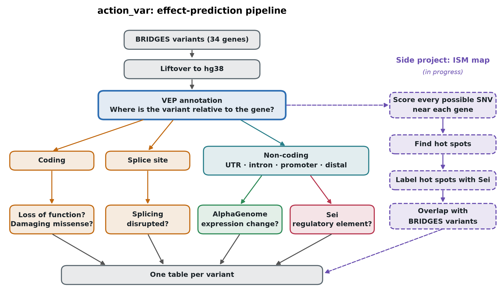

# Download ensembl-vep:
cd resources/
singularity pull ensembl-vep.sif docker://ensemblorg/ensembl-vep:release_111.0

# Test if it works:
singularity exec ensembl-vep.sif vep --help

VEP description:
Ensembl VEP (Variant Effect Predictor) is a tool that takes genomic variants — SNVs, indels, structural variants — and annotates them with their predicted functional consequences.

Core function

Given a variant (e.g. from a VCF file), VEP determines which genes and transcripts it overlaps and predicts what effect it has, such as:

Missense, nonsense, synonymous, frameshift
Splice site disruption (donor/acceptor, splice region)
5'/3' UTR variants
Intronic, intergenic
Regulatory region and non-coding RNA effects
Upstream/downstream gene variants

For coding variants, it gives HGVS notation (c., p.), amino acid changes, and codon changes.

Consequence ranking

VEP assigns a "most severe consequence" per variant using Sequence Ontology terms, and can report all overlapping transcript consequences, not just the worst one — relevant when a variant hits multiple transcript isoforms differently.

Annotation sources it can pull in


# Modules

## Input variants

The `variants` entry in the config file points to a delimited text file (plain or `.gz`) with a header line and one variant per row. These columns are required:

| Column | Description |
|---|---|
| `VariantID` | Variant identifier, conventionally `<Chromosome>_<Position>_<Ref>_<Alt>` |
| `Chromosome` | Chromosome, with or without a `chr` prefix (`10` or `chr10`) |
| `Position` | 1-based position (VCF convention) |
| `Ref` | Reference allele (A/C/G/T) |
| `Alt` | Alternate allele (A/C/G/T) |

Example:

```
VariantID;Chromosome;Position;Ref;Alt
10_89624151_C_T;10;89624151;C;T
10_89624278_GA_G;10;89624278;GA;G
```

- **Separator:** `;`, tab, `,` or `|`, detected from the header line.
- **Genome build:** set `variants_build` in the config (e.g. `hg19`). If it is not `hg38`, the variants are lifted to hg38 before annotation. Variants that cannot be lifted are written to `<output>.unmapped`.
- **Indels:** use VCF-style representation, where Ref and Alt share the first base (e.g. `GA>G`, `A>AC`). Only the start position is lifted, so long indels are less reliable than SNVs.
- **Extra columns** are allowed and are passed through unchanged.
- **Recommended:** remove duplicate rows and left-normalise the variants (e.g. with `bcftools norm`) beforehand. Ref alleles are not checked against the reference genome.

## Workflow DAG

Rule graph for `config/config_full_BRIDGES34_variants.yaml`:


## Output: `annotate_vep`

| File | Description |
|---|---|
| `<output>` | VEP-annotated VCF. Default `results/<input stem>_vep.vcf`, or `vep.output` in the config. This is the only file tracked by Snakemake. |
| `<output stem>.input.vcf` | The VCF built from the input table and passed to VEP, kept for provenance. |
| `<output>_summary.html` | VEP's run summary (consequence and gene counts). |

### Annotated VCF

- One record per input variant, with `chr`-prefixed GRCh38 coordinates, sorted by chromosome name and position.
- `ID` is the input `VariantID`. `QUAL` and `FILTER` are `.`.
- Only rows with a missing `Position`, `Ref` or `Alt` are removed, so duplicate input rows remain duplicated.
- The header records the VEP version (111), the cache, the annotation sources and the full VEP command line.

All annotations are in the `CSQ` INFO field. It holds one comma-separated entry per overlapping transcript or feature, not only the most severe consequence, so a variant can have many entries. Each entry has these `|`-separated fields:

```
Allele|Consequence|IMPACT|SYMBOL|Gene|Feature_type|Feature|BIOTYPE|EXON|INTRON|HGVSc|HGVSp|
cDNA_position|CDS_position|Protein_position|Amino_acids|Codons|Existing_variation|DISTANCE|
STRAND|FLAGS|SYMBOL_SOURCE|HGNC_ID|REFSEQ_MATCH|REFSEQ_OFFSET
```

| Field | Description |
|---|---|
| `Consequence` | Sequence Ontology terms, combined with `&` (e.g. `missense_variant&splice_region_variant`) |
| `IMPACT` | `HIGH`, `MODERATE`, `LOW` or `MODIFIER` |
| `SYMBOL`, `Gene` | Gene symbol and Entrez gene ID |
| `Feature` | RefSeq transcript (`NM_…`, `XM_…`) |
| `EXON`, `INTRON` | Exon or intron number, as `n/total` |
| `Amino_acids`, `Codons` | Amino acid and codon change (e.g. `*/S`, `tGa/tCa`) |

With the current VEP settings, some fields are always empty or missing:

- `HGVSc` and `HGVSp` are empty, because no reference FASTA is given (`--fasta`).
- `Existing_variation` is empty, because known variants are not looked up (`--check_existing`).
- SIFT, PolyPhen and allele frequencies are not included.

To get one entry per variant, add `--pick` to the VEP call in `annotate_vep.py`. By default this prefers MANE Select transcripts, then canonical transcripts, then the most severe consequence. Use `--pick_order` to change this.

## Effect prediction modules



`config/config_effects_BRIDGES34_variants.yaml` runs the full chain. The modules are included in dependency order whatever their order in `modules`:

| Module | Needs | Output |
|---|---|---|
| `annotate_vep` | input variants | VEP VCF (+ SIFT, PolyPhen and plugins when configured), `vep_report` HTML and annotated CSV |
| `variant_effects` | `annotate_vep` | `<vep stem>_effects.tsv`: Denise's criteria per variant, plus a per-gene summary |
| `alphagenome` | `variant_effects` | `<vep stem>_alphagenome/`: Atlas scores for non-coding SNVs, model-API scores for indels and Atlas misses |
| `sei` | `variant_effects` | `<vep stem>_sei/variant_effects_sei.tsv`: the effects table plus Sei sequence-class scores |
| `alphagenome_ism` | `annotate_vep` | design skeleton, see `docs/ism_sei_design.md` |

### Denise's criteria (`variant_effects`)

| Question | Tool | Default threshold | Source |
|---|---|---|---|
| Loss of function? | VEP consequence | LoF term (stop gained, frameshift, canonical splice, start lost, transcript ablation) | VEP |
| Damaging missense? | SIFT | deleterious | VEP cache (`vep.sift`) |
| | PolyPhen | ≥ 0.85 | VEP cache (`vep.polyphen`) |
| | AlphaMissense | likely pathogenic | dbNSFP or AlphaMissense plugin |
| | REVEL | ≥ 0.6 | dbNSFP or REVEL plugin |
| | MetaRNN | ≥ 0.8 | dbNSFP plugin |
| Splicing disrupted? | dbscSNV | ADA and RF ≥ 0.9 | dbscSNV plugin |
| | MaxEntScan | \|diff\| ≥ 2 | MaxEntScan plugin |
| | SpliceAI | max DS ≥ 0.5 | SpliceAI plugin (precomputed scores) |
| Expression altered? | ExPectoSC | \|z\| > 1 in any cell type | `variant_effects.expectosc.table` |

Thresholds are set under `variant_effects.thresholds`. Every per-tool flag is NA when the tool gave no value, so a missing plugin shows up as empty columns, and the log lists which tools were found. `damaging_missense` needs at least `missense_min_tools` tools (default 1) *and* a missense consequence; `splice_disrupted` needs `splice_min_tools` (default 1). The consequence is taken on the MANE Select transcript of a target gene; gene and region come from `vep_report`, so distal variants are assigned to the nearest target gene.

### VEP plugin data

The ensembl-vep image contains the plugin code but not the data. Download once into a bound path (e.g. `resources/vep_plugins/`, git-ignored) and list it under `vep.plugins`:

- **dbNSFP** (REVEL, MetaRNN, AlphaMissense in one file; academic licence): https://www.dbnsfp.org. Build the GRCh38 file as described in the dbNSFP plugin header.
- **dbscSNV 1.1**: from the dbNSFP site; build the GRCh38 file as in the dbscSNV plugin header.
- **MaxEntScan**: `fordownload.tar.gz` from the Burge lab (`http://hollywood.mit.edu/burgelab/maxent/download/`).
- **SpliceAI** precomputed scores (`spliceai_scores.raw.{snv,indel}.hg38.vcf.gz`): Illumina BaseSpace, free account, licence terms apply.
- **AlphaMissense** (alternative to the dbNSFP fields): `https://storage.googleapis.com/dm_alphamissense/AlphaMissense_hg38.tsv.gz`, then `tabix -s 1 -b 2 -e 2 -f -S 1`.

Plugin data versions should match VEP 111; see https://www.ensembl.org/info/docs/tools/vep/script/vep_plugins.html. If VEP cannot find a plugin, check where the image keeps them (`singularity exec containers/ensembl-vep.sif ls /plugins`) and set `vep.dir_plugins`. Check after the first run that the log of `classify_variant_effects` lists SIFT and PolyPhen: the RefSeq cache should carry them, but verify.

### AlphaGenome (`alphagenome`)

- Selects `coding == False` variants (UTR, intron, canonical splice, promoter and distal variants are kept; set `alphagenome.include: all` for everything).
- `backend: atlas`: SNVs from the AlphaGenome Atlas (stored scores, fast), queried per target gene so gene-level scorers report the effect on that gene. Indels and SNVs the Atlas does not hold go to the model API in batches of `alphagenome.model.batch_size`. `backend: model` sends everything to the model API.
- Model-API output is filtered to `ontology_terms` (default mammary epithelial cell, CL:0002327) and to the variant's own gene, which keeps the table small.
- Both steps cache per batch, so an interrupted run resumes.
- **API key**: `resources/API_KEY` (git-ignored), `$ALPHAGENOME_API_KEY`, or `alphagenome.api_key_file`. Never put it in a script.

Outputs: `atlas_scores.parquet` (one row per variant, one column per track, `|q` = calibrated quantile), `atlas_missing.tsv`, `model_scores.parquet` (long, as `tidy_scores`).

### Sei (`sei`)

One-off setup:

```
git clone https://github.com/FunctionLab/sei-framework
cd sei-framework && sh ./download_data.sh        # model + hg19/hg38 FASTA, several GB
conda create -n sei python=3.9 && conda activate sei
pip install torch selene-sdk docopt h5py pandas  # pick the torch build for your CUDA, if any
```

Set `sei.dir` to the checkout and `sei.run_prefix` to how its Python is run (default `conda run --no-capture-output -n sei`). Step 1 (`sei_chromatin`, 21,907 chromatin profiles for ref and alt) is the slow one: on CPU try a small set first, or set `sei.cuda: true` and `sei.resources` (e.g. `{slurm_partition: accel, gpus: 1}`) to run just that rule on a Fox GPU node. Step 1 also writes ref, alt and diff HDF5 files of 21,907 columns per variant, so expect several GB for tens of thousands of variants.

`variant_effects_sei.tsv` adds: `sei_ref_match` (False = the VCF REF did not match Sei's FASTA, so check those), `sei_max_abs`, `sei_top_class` and `sei_top_score`, the signed strongest class per group (`sei_P_max`, `sei_E_max`, `sei_TF_max`, `sei_CTCF_max`, ...), and all 40 classes (`sei_TF3` = FOXA1/AR/ESR1, `sei_E6` = weak epithelial, ...). Scores are alt − ref sequence-class activity, histone-normalised. `sei_sequence_class_scores_long.tsv` has the same scores in long format. Sei is licensed for academic and research use only.
