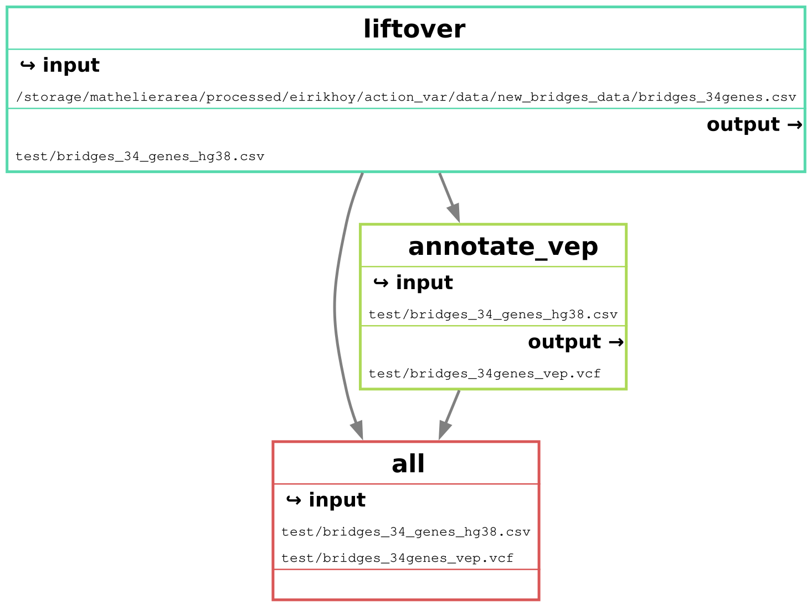

# Download ensembl-vep:
cd resources/
singularity pull ensembl-vep.sif docker://ensemblorg/ensembl-vep:release_111.0

# Test if it works:
singularity exec ensembl-vep.sif vep --help

VEP description:
Ensembl VEP (Variant Effect Predictor) is a tool that takes genomic variants — SNVs, indels, structural variants — and annotates them with their predicted functional consequences.

Core function

Given a variant (e.g. from a VCF file), VEP determines which genes and transcripts it overlaps and predicts what effect it has, such as:

Missense, nonsense, synonymous, frameshift
Splice site disruption (donor/acceptor, splice region)
5'/3' UTR variants
Intronic, intergenic
Regulatory region and non-coding RNA effects
Upstream/downstream gene variants

For coding variants, it gives HGVS notation (c., p.), amino acid changes, and codon changes.

Consequence ranking

VEP assigns a "most severe consequence" per variant using Sequence Ontology terms, and can report all overlapping transcript consequences, not just the worst one — relevant when a variant hits multiple transcript isoforms differently.

Annotation sources it can pull in


# Modules

## Input variants

The `variants` entry in the config file points to a delimited text file (plain or `.gz`) with a header line and one variant per row. These columns are required:

| Column | Description |
|---|---|
| `VariantID` | Variant identifier, conventionally `<Chromosome>_<Position>_<Ref>_<Alt>` |
| `Chromosome` | Chromosome, with or without a `chr` prefix (`10` or `chr10`) |
| `Position` | 1-based position (VCF convention) |
| `Ref` | Reference allele (A/C/G/T) |
| `Alt` | Alternate allele (A/C/G/T) |

Example:

```
VariantID;Chromosome;Position;Ref;Alt
10_89624151_C_T;10;89624151;C;T
10_89624278_GA_G;10;89624278;GA;G
```

- **Separator:** `;`, tab, `,` or `|`, detected from the header line.
- **Genome build:** set `variants_build` in the config (e.g. `hg19`). If it is not `hg38`, the variants are lifted to hg38 before annotation. Variants that cannot be lifted are written to `<output>.unmapped`.
- **Indels:** use VCF-style representation, where Ref and Alt share the first base (e.g. `GA>G`, `A>AC`). Only the start position is lifted, so long indels are less reliable than SNVs.
- **Extra columns** are allowed and are passed through unchanged.
- **Recommended:** remove duplicate rows and left-normalise the variants (e.g. with `bcftools norm`) beforehand. Ref alleles are not checked against the reference genome.

## Workflow DAG

Rule graph for `config/config_full_BRIDGES34_variants.yaml`:



## Output: `annotate_vep`

| File | Description |
|---|---|
| `<output>` | VEP-annotated VCF. Default `results/<input stem>_vep.vcf`, or `vep.output` in the config. This is the only file tracked by Snakemake. |
| `<output stem>.input.vcf` | The VCF built from the input table and passed to VEP, kept for provenance. |
| `<output>_summary.html` | VEP's run summary (consequence and gene counts). |

### Annotated VCF

- One record per input variant, with `chr`-prefixed GRCh38 coordinates, sorted by chromosome name and position.
- `ID` is the input `VariantID`. `QUAL` and `FILTER` are `.`.
- Only rows with a missing `Position`, `Ref` or `Alt` are removed, so duplicate input rows remain duplicated.
- The header records the VEP version (111), the cache, the annotation sources and the full VEP command line.

All annotations are in the `CSQ` INFO field. It holds one comma-separated entry per overlapping transcript or feature, not only the most severe consequence, so a variant can have many entries. Each entry has these `|`-separated fields:

```
Allele|Consequence|IMPACT|SYMBOL|Gene|Feature_type|Feature|BIOTYPE|EXON|INTRON|HGVSc|HGVSp|
cDNA_position|CDS_position|Protein_position|Amino_acids|Codons|Existing_variation|DISTANCE|
STRAND|FLAGS|SYMBOL_SOURCE|HGNC_ID|REFSEQ_MATCH|REFSEQ_OFFSET
```

| Field | Description |
|---|---|
| `Consequence` | Sequence Ontology terms, combined with `&` (e.g. `missense_variant&splice_region_variant`) |
| `IMPACT` | `HIGH`, `MODERATE`, `LOW` or `MODIFIER` |
| `SYMBOL`, `Gene` | Gene symbol and Entrez gene ID |
| `Feature` | RefSeq transcript (`NM_…`, `XM_…`) |
| `EXON`, `INTRON` | Exon or intron number, as `n/total` |
| `Amino_acids`, `Codons` | Amino acid and codon change (e.g. `*/S`, `tGa/tCa`) |

With the current VEP settings, some fields are always empty or missing:

- `HGVSc` and `HGVSp` are empty, because no reference FASTA is given (`--fasta`).
- `Existing_variation` is empty, because known variants are not looked up (`--check_existing`).
- SIFT, PolyPhen and allele frequencies are not included.

To get one entry per variant, add `--pick` to the VEP call in `annotate_vep.py`. By default this prefers MANE Select transcripts, then canonical transcripts, then the most severe consequence. Use `--pick_order` to change this.
